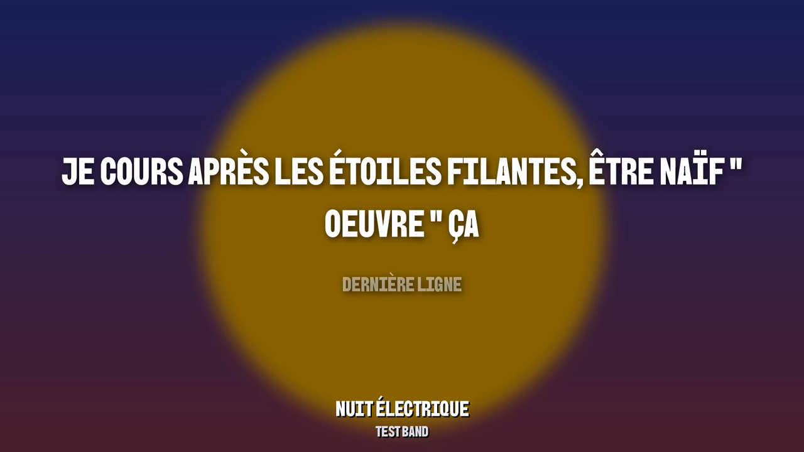
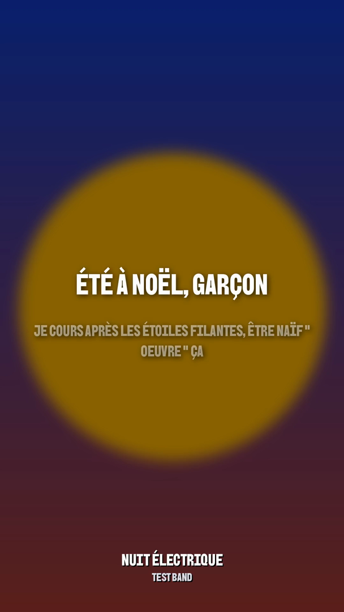

# Lyric Video Maker

Appli Windows qui transforme une musique en **vidéo de paroles** prête à publier :

- la vidéo dure **tout le morceau** ;
- la **pochette** de l'album est en fond, floutée et assombrie ;
- les **paroles synchronisées** s'affichent au premier plan (police BBH Bogle), avec la ligne suivante en aperçu ;
- le **titre et l'artiste** sont en bas, au centre ;
- au choix : **16:9** (YouTube), **9:16** (TikTok / Reels / Shorts), **1:1** (carré) ou **4:5** (post Instagram).

| 16:9 | 9:16 |
|---|---|
|  |  |

---

## Installation (Windows)

### Le plus simple : télécharger l'exe

1. Va dans **[Releases](../../releases/latest)** et télécharge **`LyricVideoMaker.exe`**.
2. Double-clique dessus. Rien d'autre à installer (Python et ffmpeg sont inclus dans l'exe).

> Au premier lancement, Windows SmartScreen peut afficher « Windows a protégé votre ordinateur » car l'exe n'est pas signé :
> clique sur **Informations complémentaires → Exécuter quand même**. Le démarrage prend quelques secondes (l'exe se décompresse).

### Depuis le code source

1. Installe **Python 3.10 ou plus** depuis [python.org](https://www.python.org/downloads/) en cochant **« Add Python to PATH »**.
2. Télécharge le projet : bouton **Code → Download ZIP**, puis dézippe-le.
3. Lance **`run.bat`** (installe les dépendances et ouvre l'appli), ou **`build.bat`** pour créer toi-même `dist\LyricVideoMaker.exe`.

> L'appli fonctionne aussi sous macOS et Linux avec `pip install -r requirements.txt` puis `python app.py` (tkinter requis).

### Nouvelles versions

L'exe est reconstruit automatiquement par GitHub Actions (`.github/workflows/build-exe.yml`)
à chaque modification du code sur `main` : une nouvelle release `v1.0.N` apparaît quelques minutes plus tard.
On peut aussi la relancer à la main depuis l'onglet **Actions → Build Windows exe → Run workflow**.

## Utilisation

1. **Choisir une musique** (MP3, M4A, FLAC, OGG, WAV, AAC).
   Le titre, l'artiste et la pochette sont lus dans les tags du fichier. Si le fichier n'a pas de pochette,
   l'appli la cherche en ligne (Deezer puis iTunes) à partir du titre et de l'artiste.
   Tu peux corriger le titre/l'artiste puis cliquer **Chercher la pochette en ligne**, ou choisir ta propre image avec **Changer la pochette**.
2. Les **paroles synchronisées** sont cherchées automatiquement sur [LRCLIB](https://lrclib.net) (base gratuite et ouverte).
   Si rien n'est trouvé, colle les paroles dans la zone de texte :
   - au **format LRC** (`[01:23.45] ma ligne`) → synchro exacte ;
   - en **texte simple** (une ligne par phrase) → réparties régulièrement sur le morceau, donc approximatives.
   - une ligne LRC vide (`[02:10.00]`) crée une pause sans texte (solo, refrain instrumental…).
3. Choisis le **Format**.
4. **Créer la vidéo**, puis choisis où enregistrer le `.mp4`. Une barre de progression s'affiche ; le rendu est généralement bien plus rapide que la durée du morceau.

## Détails techniques

| | |
|---|---|
| Sortie | MP4 H.264 (CRF 20) + AAC 192 kb/s, 30 images/s |
| Résolutions | 1920×1080, 1080×1920, 1080×1080, 1080×1350 |
| Paroles | API LRCLIB `/api/get` puis `/api/search` (le résultat dont la durée est la plus proche) |
| Dépendances | `mutagen` (tags), `Pillow` + `numpy` (images), `imageio-ffmpeg` (encodage), `pyinstaller` (exe) |

### Structure

```
app.py                interface (tkinter)
lyricvideo_core.py    moteur : tags, paroles, rendu des images, encodage ffmpeg
fonts/                police BBH Bogle + licence OFL
run.bat / build.bat   lancement et création de l'exe sous Windows
```

Le moteur peut s'utiliser sans interface :

```python
import lyricvideo_core as core

title, artist, duration, cover = core.read_tags("musique.mp3")
lyrics = core.lyrics_from_text(core.fetch_lrclib(title, artist, duration), duration)
core.render_video("musique.mp3", "clip.mp4", title, artist, cover, lyrics, duration,
                  size=core.RATIOS["9:16 - TikTok / Reels / Shorts (1080x1920)"])
```

### À propos des accents

La police BBH Bogle ne contient pas de lettres accentuées. L'appli dessine donc elle-même les accents
(é è ê ë à ç…) au-dessus de la lettre de base, dans l'épaisseur de la police. Les guillemets « » sont
remplacés par `"` et `œ` par `oe`. La police s'affiche toujours en majuscules : c'est son style.

## Limites connues

- Les paroles en texte simple ne sont pas vraiment synchronisées : utilise du LRC pour un résultat propre.
- La recherche de paroles et de pochette nécessite une connexion internet.
- Pense aux droits d'auteur avant de publier une vidéo avec une musique qui ne t'appartient pas.

## Licence

Code sous licence [GNU GPL v3](LICENSE) : tu peux utiliser, modifier et redistribuer ce projet, à condition que toute version modifiée distribuée reste open source sous GPL v3. Police BBH Bogle sous [SIL Open Font License 1.1](fonts/OFL.txt).
