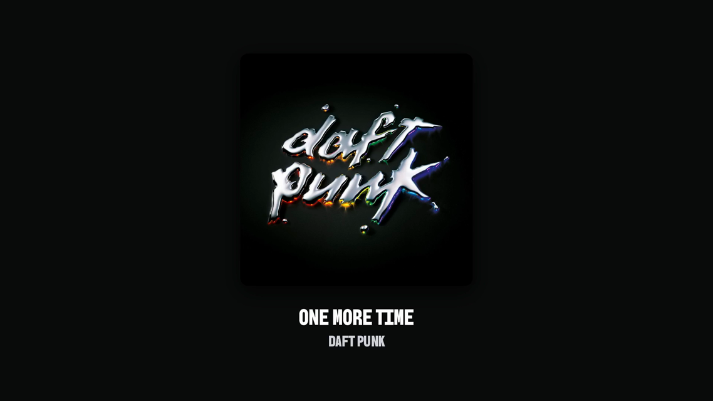

# Lyric Video Maker

📖 **[Wiki](https://github.com/hdW76/lyric-video-maker/wiki)** : [Installation](https://github.com/hdW76/lyric-video-maker/wiki/Installation) · [Utilisation](https://github.com/hdW76/lyric-video-maker/wiki/Utilisation) · [Paroles et format LRC](https://github.com/hdW76/lyric-video-maker/wiki/Paroles-et-format-LRC) · [Pochettes](https://github.com/hdW76/lyric-video-maker/wiki/Pochettes) · [Formats vidéo](https://github.com/hdW76/lyric-video-maker/wiki/Formats-video) · [Mode sans paroles](https://github.com/hdW76/lyric-video-maker/wiki/Mode-sans-paroles) · [Plusieurs vidéos en même temps](https://github.com/hdW76/lyric-video-maker/wiki/Plusieurs-videos) · [FAQ et dépannage](https://github.com/hdW76/lyric-video-maker/wiki/FAQ-et-depannage) · [Développement](https://github.com/hdW76/lyric-video-maker/wiki/Developpement)

⬇ **[Télécharger l'exe](https://github.com/hdW76/lyric-video-maker/releases/latest)**

Appli Windows qui transforme une musique en **vidéo de paroles** prête à publier :

- la vidéo dure **tout le morceau** ;
- la **pochette** de l'album est en fond, floutée et assombrie ;
- les **paroles synchronisées** s'affichent au premier plan (police BBH Bogle), avec la ligne suivante en aperçu ;
- le **titre et l'artiste** sont en bas, au centre ;
- au choix : **16:9** (YouTube), **9:16** (TikTok / Reels / Shorts), **1:1** (carré) ou **4:5** (post Instagram).

| 16:9 | 9:16 |
|---|---|
|  |  |

Sans paroles :



---

## Installation (Windows)

### Le plus simple : télécharger l'exe

1. Va dans **[Releases](../../releases/latest)** et télécharge **`LyricVideoMaker.exe`**.
2. Double-clique dessus. Rien d'autre à installer (Python et ffmpeg sont inclus dans l'exe).

> Au premier lancement, Windows SmartScreen peut afficher « Windows a protégé votre ordinateur » car l'exe n'est pas signé :
> clique sur **Informations complémentaires → Exécuter quand même**. Le démarrage prend quelques secondes (l'exe se décompresse).

### Depuis le code source

1. Installe **Python 3.10 ou plus** depuis [python.org](https://www.python.org/downloads/) en cochant **« Add Python to PATH »**.
2. Télécharge le projet : bouton **Code → Download ZIP**, puis dézippe-le.
3. Lance **`run.bat`** (installe les dépendances et ouvre l'appli), ou **`build.bat`** pour créer toi-même `dist\LyricVideoMaker.exe`.

> L'appli fonctionne aussi sous macOS et Linux avec `pip install -r requirements.txt` puis `python app.py` (tkinter requis).

### Nouvelles versions

L'exe est reconstruit automatiquement par GitHub Actions (`.github/workflows/build-exe.yml`)
à chaque modification du code sur `main`. Le moteur, l'interface et l'exe final sont testés avant publication,
puis une nouvelle release `v1.0.N` apparaît quelques minutes plus tard.
On peut aussi la relancer à la main depuis l'onglet **Actions → Build Windows exe → Run workflow**.

## Utilisation

1. **Ajouter des musiques…** : choisis un ou plusieurs fichiers (MP3, M4A, FLAC, OGG, Opus, WAV, AAC).
   Ils apparaissent dans la liste avec leur format, l'état des paroles et l'état du rendu.
2. Clique sur une musique de la liste pour modifier **ses** réglages (chaque musique a les siens) :
   - **Titre / Artiste** : lus dans les tags du fichier, modifiables.
   - **Pochette** : lue dans le fichier ; sinon cherchée en ligne (Deezer puis iTunes). Boutons
     **Chercher la pochette en ligne** et **Changer la pochette…** pour corriger.
   - **Format** : 16:9 (YouTube), 9:16 (TikTok / Reels / Shorts), 1:1 ou 4:5 (Instagram).
   - **Paroles** : cherchées automatiquement sur [LRCLIB](https://lrclib.net). Sinon, colle-les :
     - au **format LRC** (`[01:23.45] ma ligne`) → synchro exacte ;
     - en **texte simple** → réparties régulièrement sur le morceau (approximatif) ;
     - une ligne LRC vide (`[02:10.00]`) crée une pause sans texte.
   - **Afficher les paroles** décoché : pochette nette au centre (sans flou), sur un fond uni de sa couleur
     dominante, avec le titre et l'artiste juste en dessous.
   - **Appliquer ce format et ce mode à toutes** copie le format et le choix avec/sans paroles sur toute la liste.
3. Règle **Vidéos en même temps** (par défaut : la moitié des cœurs de ton processeur, 4 max).
4. **Créer toutes les vidéos**, puis choisis le dossier de sortie. Chaque vidéo est enregistrée sous le nom
   du fichier audio (`ma musique.mp4`, sans jamais écraser un fichier existant). La colonne **État** suit
   chaque rendu, et **Annuler** arrête tout.

## Détails techniques

| | |
|---|---|
| Sortie | MP4 H.264 (CRF 20) + AAC 192 kb/s, 30 images/s |
| Résolutions | 1920×1080, 1080×1920, 1080×1080, 1080×1350 |
| Paroles | API LRCLIB `/api/get` puis `/api/search` (le résultat dont la durée est la plus proche) |
| Rendu en parallèle | un processus par vidéo (`ProcessPoolExecutor`), donc plusieurs cœurs utilisés |
| Dépendances | `mutagen` (tags), `Pillow` + `numpy` (images), `imageio-ffmpeg` (encodage), `pyinstaller` (exe) |

### Structure

```
app.py                interface (tkinter)
lyricvideo_core.py    moteur : tags, pochette, paroles, rendu des images, encodage ffmpeg
tests/                tests lancés par GitHub Actions (moteur, interface, exe)
wiki/                 sources du wiki GitHub (publiées automatiquement)
fonts/                police BBH Bogle + licence OFL
run.bat / build.bat   lancement et création de l'exe sous Windows
```

Le moteur peut s'utiliser sans interface :

```python
import lyricvideo_core as core

title, artist, duration, cover = core.read_tags("musique.mp3")
lyrics = core.lyrics_from_text(core.fetch_lrclib(title, artist, duration), duration)
core.render_video("musique.mp3", "clip.mp4", title, artist, cover, lyrics, duration,
                  size=core.RATIOS["9:16 - TikTok / Reels / Shorts (1080x1920)"])
```

### À propos des accents

La police BBH Bogle ne contient pas de lettres accentuées. L'appli dessine donc elle-même les accents
(é è ê ë à ç…) au-dessus de la lettre de base, dans l'épaisseur de la police. Les guillemets « » sont
remplacés par `"` et `œ` par `oe`. La police s'affiche toujours en majuscules : c'est son style.

## Limites connues

- Les paroles en texte simple ne sont pas vraiment synchronisées : utilise du LRC pour un résultat propre.
- La recherche de paroles et de pochette nécessite une connexion internet.
- Pense aux droits d'auteur avant de publier une vidéo avec une musique qui ne t'appartient pas.

## Licence

Code sous licence [GNU GPL v3](LICENSE) : tu peux utiliser, modifier et redistribuer ce projet, à condition que toute version modifiée distribuée reste open source sous GPL v3. Police BBH Bogle sous [SIL Open Font License 1.1](fonts/OFL.txt).
