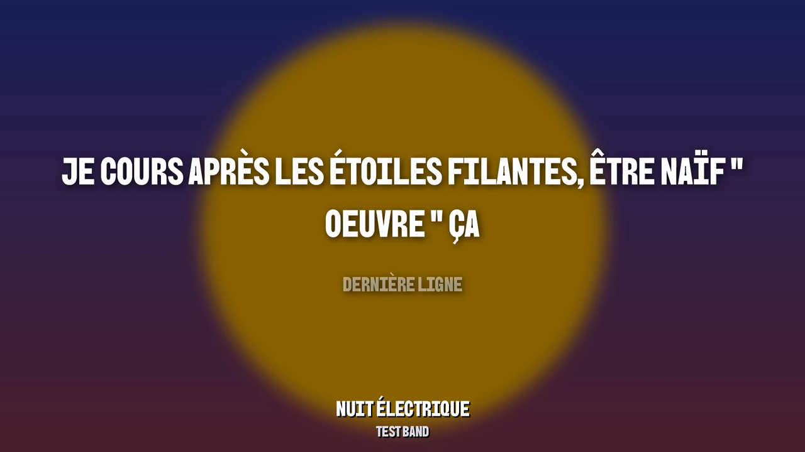

# Lyric Video Maker — Wiki

**Pages :** [Installation](Installation) · [Utilisation](Utilisation) · [Paroles et format LRC](Paroles-et-format-LRC) · [Pochettes](Pochettes) · [Formats vidéo](Formats-video) · [Mode sans paroles](Mode-sans-paroles) · [Plusieurs vidéos en même temps](Plusieurs-videos) · [FAQ et dépannage](FAQ-et-depannage) · [Développement](Developpement)

**[⬇ Télécharger l'exe](https://github.com/hdW76/lyric-video-maker/releases/latest)**

**Lyric Video Maker** est une appli Windows qui transforme une musique en vidéo prête à publier :
pochette en fond, paroles synchronisées au premier plan, titre et artiste en bas.

## Démarrer

| Je veux… | Page |
|---|---|
| installer l'appli | [Installation](Installation) |
| faire ma première vidéo | [Utilisation](Utilisation) |
| comprendre / écrire des paroles synchronisées | [Paroles et format LRC](Paroles-et-format-LRC) |
| savoir d'où vient la pochette | [Pochettes](Pochettes) |
| choisir entre 16:9, 9:16, 1:1, 4:5 | [Formats vidéo](Formats-video) |
| faire une vidéo sans paroles | [Mode sans paroles](Mode-sans-paroles) |
| créer plusieurs vidéos d'un coup | [Plusieurs vidéos en même temps](Plusieurs-videos) |
| régler un problème | [FAQ et dépannage](FAQ-et-depannage) |
| modifier le code / contribuer | [Développement](Developpement) |

## En bref

- **Entrée** : MP3, M4A, FLAC, OGG, Opus, WAV, AAC.
- **Sortie** : MP4 (H.264 + AAC), 30 images/s, durée = durée de la musique.
- **Paroles** : trouvées automatiquement sur [LRCLIB](https://lrclib.net), ou collées à la main.
- **Pochette** : lue dans le fichier, sinon cherchée sur Deezer puis iTunes.
- **Police** : BBH Bogle (majuscules), accents français dessinés par l'appli.
- **Licence** : GPL v3 (code), SIL OFL 1.1 (police).

> Ce wiki est généré depuis le dossier [`wiki/`](https://github.com/hdW76/lyric-video-maker/tree/main/wiki) du dépôt :
> pour le corriger, modifie les fichiers là-bas (voir [[Développement|Developpement]]).
