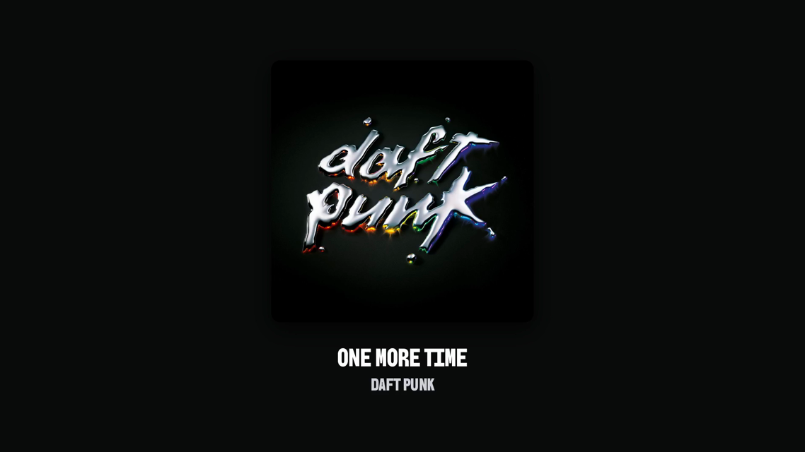

# Mode sans paroles

Décoche **Afficher les paroles** dans les réglages d'une musique.

La vidéo devient :

- **pochette nette** (pas de flou), en carré au centre, coins arrondis et ombre douce ;
- **fond uni** de la couleur dominante de la pochette, assombrie ;
- **titre et artiste juste en dessous** de la pochette.

La zone de paroles est grisée et ignorée. Le rendu est plus rapide (l'image ne change pas).

Pour l'appliquer à toute la liste : **Appliquer ce format et ce mode à toutes**.
